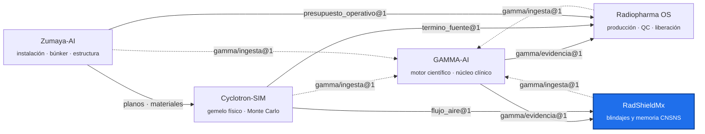

<!-- encabezado-gamma -->
<div align="center">

# RadShield-MX

**Diseño, cálculo y memoria de blindajes radiológicos para instalaciones médicas**

[](https://github.com/plaeyade/RadShieldMx/actions/workflows/ci.yml)    

[Qué aporta](#qué-aporta) · [Capacidades](#capacidades) · [Sustento científico](#sustento-científico) · [Diferencias con otros programas](#diferencias-con-otros-programas) · [Integración con el ecosistema](#integración-con-el-ecosistema) · [Ecosistema GAMMA](#ecosistema-gamma)

</div>

> [!IMPORTANT]
> Repositorio privado, de uso individual del titular. Los cálculos y memorias que produce son herramientas de ingeniería: la firma y la responsabilidad regulatoria (CNSNS) son del físico médico responsable.
<!-- /encabezado-gamma -->

RadShield-MX diseña, calcula y documenta blindajes radiológicos de instalaciones médicas: rayos X
diagnósticos, tomografía, mastografía, fluoroscopía, medicina nuclear y PET/CT, teleterapia de
megavoltaje, braquiterapia HDR y ciclotrones. Del plano arquitectónico sale un modelo, del modelo el
cálculo por barrera, y del cálculo la memoria analítica para la CNSNS con cada número citado.

## Qué aporta

- **Cálculo normativo, no aproximado.** Las barreras se calculan con las ecuaciones y tablas de los
  informes originales (NCRP 147, NCRP 151, AAPM TG-108) y las pruebas reproducen los ejemplos
  resueltos de esos informes.
- **Trazabilidad completa.** Cada barrera guarda su método, supuestos, tablas usadas y avisos. La
  memoria cita documento, página y fragmento verificados por SHA-256 desde GAMMA-AI.
- **Instalación real, no genérica.** El búnker del ciclotrón usa el término fuente y el flujo de
  neutrones del Monte Carlo de Cyclotron-SIM, calibrado contra la guía del fabricante.
- **Del plano a la obra.** Espesor, masa por m², carga estructural y costo por material, para
  decidir entre concreto, plomo, acero o tabiques de alta densidad.

## Capacidades

| Área | Qué hace |
|---|---|
| Plano | Importación DXF/DWG/PDF con mapeo de capas y verificación de escala; lienzo CAD 2D con barreras, fuentes, regiones y puntos de control |
| Diagnóstico (NCRP 147) | Barreras primarias y secundarias por distribución de carga TG9 (Tablas 4.5, 4.7, B.1, C.1); varias fuentes a la vez; TC por método DLP con κ (§5.6) |
| Teleterapia (NCRP 151) | Primaria con TVL₁/TVLₑ, fuga con carga IMRT, dispersión del paciente por ángulo, regla de las dos fuentes (Tablas B.2, B.4, B.5a, B.7) |
| Medicina nuclear y PET (TG-108) | Kerma por constante Γ, TVL a 511 keV, criterios de alta de paciente (NRC RG 8.39) |
| Ciclotrón | Tabla 8/9 de la guía IBA KIUBE por dirección; término fuente y flujo térmico del Monte Carlo; ventilación del Ar-41 |
| Materiales | Registro único con densidad, TVL citados, masa, costo y carga estructural; tabiques comerciales (Contuplex, Nipol) |
| Verificación | Espesor instalado frente al requerido, barrera por barrera; comparación conservadora (−20 % del objetivo) |
| Visualización | Mapa de dosis 2D, visor 3D (Three.js y Babylon.js) y compilación Unity WebGL; base para recorridos en realidad virtual |
| Documentos | Memoria CNSNS (.docx) con evidencia citada, reporte PDF y paquete de evidencia |

## Sustento científico

| Fuente | Qué se toma |
|---|---|
| NCRP Report No. 147 (2004) | Kerma sin blindaje por paciente, ajustes de Archer primarios y secundarios, preblindaje, κ de TC |
| NCRP Report No. 151 (2005) | TVL de concreto, acero y plomo; fuga; fracciones y TVL de dispersión; IMRT; regla de dos fuentes |
| AAPM TG-108 (2006) | Constantes Γ, TVL y transmisión de banda ancha a 511 keV |
| NRC RG 8.39 | Umbrales de actividad para el alta del paciente |
| IAEA SRS-47 | Marco para ciclotrones y aceleradores |
| IBA Cyclone KIUBE SRG (MID 55672 Rev G) | Tasas internas por dirección y tasas tras 200–230 cm de concreto |

Las tablas están transcritas en `src/lib/ncrp147.ts` y `src/lib/ncrp151.ts`, con informe y página
en cada constante. La revisión física y sus hallazgos están en `docs/revision-fisica-2026-11.md`.

**Validación contra los informes**

| Caso | Informe | RadShield |
|---|---|---|
| Unidad de tórax, muro primario, 300 pacientes/semana a 3 m | 2.2 mm Pb (NCRP 147 §5.2) | 2.2 mm |
| Transmisión de 1.66 mm Pb, Rad Room (chest bucky) | 9.3 × 10⁻⁴ (NCRP 147 Ap. A) | 9.3 × 10⁻⁴ |
| Primaria 18 MV, punto C a 7.2 m | 149.6 cm concreto (NCRP 151 §7.1.1) | 149.6 cm |
| Dispersión 18 + 6 MV a 30°, punto A | 55.6 cm (NCRP 151 §7.1.5) | 55.6 cm |
| Fuga 18 + 6 MV, punto A | 48 cm (NCRP 151 §7.1.5) | 48 cm |

## Diferencias con otros programas

Herramientas como pyrateShield, ShieldCalc o BunkerDesign calculan una modalidad o un recinto.
RadShield-MX reúne en un mismo plano todas las modalidades de un edificio, conecta el ciclotrón con
un Monte Carlo propio y produce la memoria con su evidencia citada en el formato de la CNSNS.

## Integración con el ecosistema

| Con | Contrato | Para qué |
|---|---|---|
| GAMMA-AI | `gamma/evidencia@1`, `gamma/paquete_evidencia@1` | Citas de la memoria y biblioteca de referencias en vivo |
| GAMMA-AI | `gamma/ingesta@1` (`gamma-ingesta.json`) | Registro de las normas que se indexan |
| Cyclotron-SIM | `cyclotron-sim/flujo_aire@1` | Flujo de neutrones en el aire de la bóveda (Ar-41) |
| Zumaya-AI | planos y presupuesto operativo | Geometría y carga del edificio real |

## Arquitectura

| Componente | Tecnología |
|---|---|
| Aplicación web y escritorio | React 19 · TypeScript 5.9 · Vite 7 · Zustand · Tailwind · Tauri 13 |
| API opcional | Hono · tRPC · Drizzle · MySQL 8 (la aplicación funciona completa sin servidor) |
| Pruebas | Vitest · Playwright · ESLint con trinquete |
| Contenedores | `docker-compose.yml`: frontend (nginx), API y base de datos |

```
src/lib/        motores de cálculo (ncrp147, ncrp151, normativeBarrierEngine, cyclone, nuclear…)
src/sections/   lienzo, paneles y diálogos
src/data/       paquete de evidencia de GAMMA y datos del MC
api/, db/       backend y esquema opcionales
data/pdf/       normas de libre uso (las de licencia individual quedan fuera de git)
docs/           revisión física, manuales y runbooks
```

## Uso

```bash
npm ci
npm run dev          # desarrollo
npm test             # pruebas
npm run lint:ci      # ESLint sin errores nuevos
npm run build        # producción
docker compose up -d --build   # pila completa
```

## Colaboraciones

Abierto a colaboradores invitados: físicos médicos (validación con casos reales y levantamientos),
ingenieros estructurales (cargas y detalles constructivos) y desarrolladores con experiencia en CAD,
BIM o WebXR. Las contribuciones entran por pull request con revisión y CI en verde.

## Hoja de ruta

1. Beta con el equipo de física médica, con el protocolo de prueba sobre planos reales.
2. Laberinto y puerta para ≥ 10 MV (NCRP 151 §2.4–2.5) y fotoneutrones.
3. Importación BIM (IFC) y exportación de cargas al cálculo estructural.
4. Recorrido en realidad virtual (WebXR) con el mapa de dosis 3D.

## Ecosistema GAMMA

Cinco repositorios privados unidos por contratos JSON versionados, no por imports. Este repositorio
está resaltado.



## Confidencialidad y licencia

Software propietario de uso individual del titular; no es de código abierto ni se distribuye.
Los documentos fuente son propiedad del titular, que tiene los derechos de uso. Ningún dato de
pacientes reales entra a este repositorio: los datos clínicos permanecen anonimizados y fuera de
GitHub. Las salidas técnicas no sustituyen la revisión ni la firma del profesional responsable.
